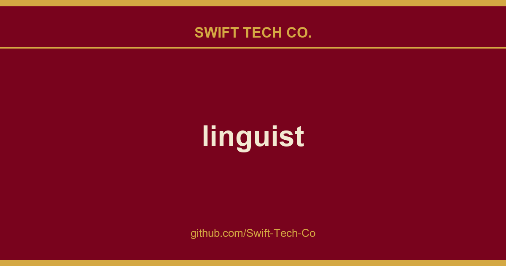
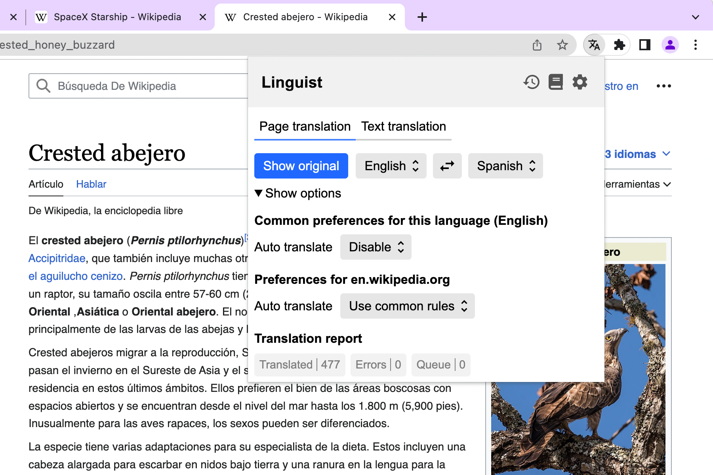
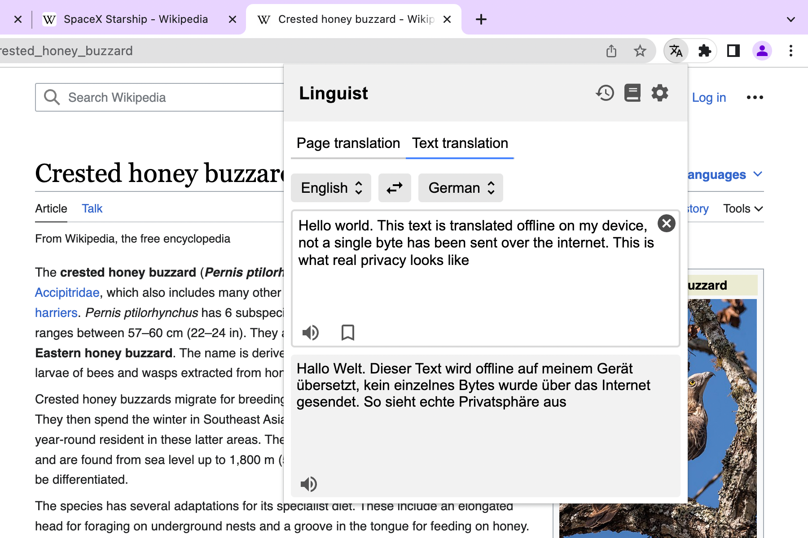
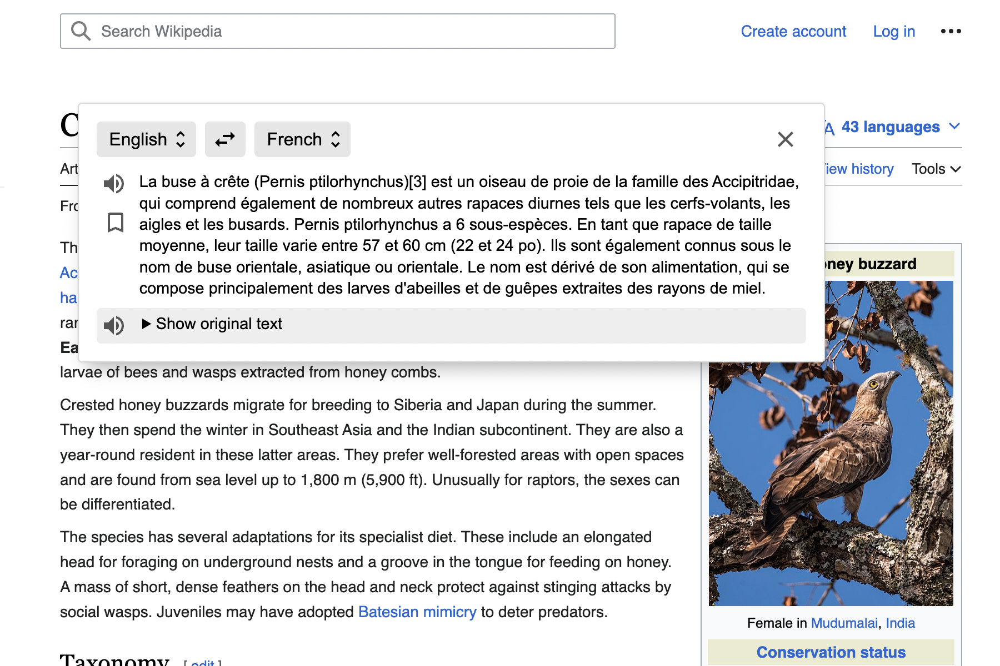
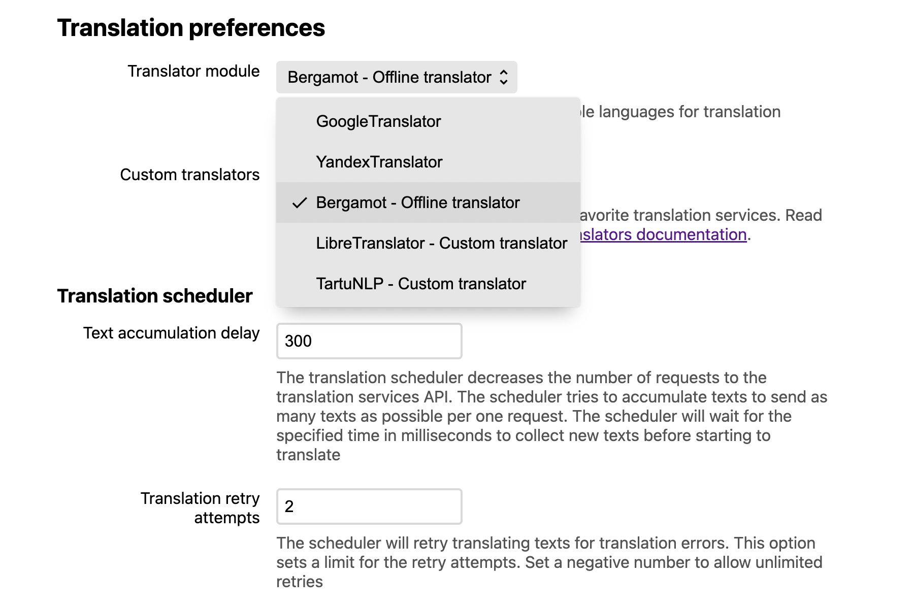

# linguist

## What This Is

This is part of the Swift Tech Co. working stack for product and engineering. It gathers the linguist notes, examples and fixes that keep delivery fast, and doubles as the reference map we hand to whoever picks up this thread next.

## Images

## Android

<!-- Text partly copied from https://github.com/Swift-Tech-Co/linguist -->

This addon can be used on mobile browsers with Firefox Nightly (Recommended), or with any chromium browser that supports extensions.

To try it on Firefox, you have to add the Linguist add-on to a custom add-on collection and use this collection to install the extension.

To try it on a chromium browser, download the normal extension for Chrome.

# Screenshots

See more info on https://github.com/Swift-Tech-Co/linguist

# Development

See [development docs](./docs/Development.md) to get info on how to build and debug.

Contribute to Linguist: file issues, suggest features, and submit pull requests. See the "help wanted" label for high-impact tasks.

# Supporters

---

## Swift Tech Co.

Built and maintained by Swift Tech Co.

AI Automation | FinTech Platforms | Custom Software and Mobile Apps | SaaS Platforms | Cloud Infrastructure | Cybersecurity | SEO and Marketing | API Integration

**Join our community on Telegram:** [t.me/+Qt_eFvkb2rliMzNh](https://t.me/+Qt_eFvkb2rliMzNh)

Home | Services | Careers | Referral Program | Influencers | About | Contact

**Connect**

- Website: https://github.com/Swift-Tech-Co/linguist
- LinkedIn: [linkedin.com/in/stephenoladoke](https://www.linkedin.com/in/stephenoladoke/)
- LinkedIn (Company): [linkedin.com/company/swift-tech-co](https://www.linkedin.com/company/swift-tech-co)
- X: [@MrOladoke](https://x.com/MrOladoke)
- Instagram: [@mr.oladoke](https://www.instagram.com/mr.oladoke/)
- Organization: [github.com/Swift-Tech-Co](https://github.com/Swift-Tech-Co)

## Sources

Compiled and maintained from upstream [github-linguist/linguist](https://github.com/github-linguist/linguist) under permissive open-source license.

---

Maintained by [Swift Tech Co.](https://github.com/Swift-Tech-Co) - [Telegram](https://t.me/+Qt_eFvkb2rliMzNh)

## Sources

Compiled and maintained from upstream [github-linguist/linguist](https://github.com/github-linguist/linguist) under permissive open-source license.

---

Maintained by [Swift Tech Co.](https://github.com/Swift-Tech-Co) - [Telegram](https://t.me/+Qt_eFvkb2rliMzNh)

## Sources

Compiled and maintained from upstream [github-linguist/linguist](https://github.com/github-linguist/linguist) under permissive open-source license.

---

Maintained by [Swift Tech Co.](https://github.com/Swift-Tech-Co) - [Telegram](https://t.me/+Qt_eFvkb2rliMzNh)